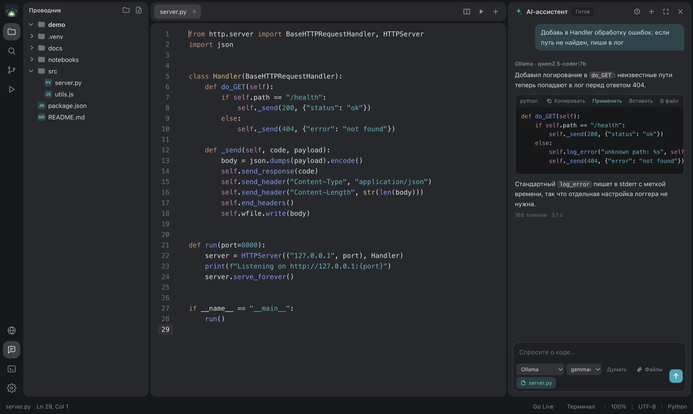

# FrogeeCodeIDE

A lightweight Electron IDE with AI that runs on your computer. Connect Ollama, LM Studio, or your own provider: the chat can see project files, suggest edits, and let you accept or revert them with a button.



## Features

**AI**
- Chat with Ollama, LM Studio, OpenRouter, and any compatible provider.
- Use files as context, edit messages, and regenerate responses.
- Review edits: changes are highlighted in the editor, with "Keep" or "Discard" actions for each file.
- Inline completions (press Tab to accept), with support for FIM models.

**Code**
- Syntax highlighting, diagnostics, find and replace, and project-wide search.
- Jupyter notebooks with automatic virtual-environment discovery and kernel selection.
- Run configurations, `package.json` scripts, and multiple terminals.
- Live Server and an integrated browser, Markdown preview, and image viewing.
- An explorer with drag-and-drop file management.

**Interface**
- Liquid Glass (window blur is available only on macOS), plus JSON light and dark themes.
- Multiple windows, a Dock menu, and tab restoration.

## Getting started

Node.js 18 or newer is required.

```bash
cd src/code-redactor
npm install
npm start
```

## Building

```bash
npm run build:mac     # .dmg
npm run build:win     # Windows installer
npm run build:linux   # AppImage / deb
```

The output is created in `src/code-redactor/dist`.

## Plugins

As in FgSNotes, plugins are `.js` and `.css` files in `~/Documents/FrogeeCodeIDE/plugins`. Settings → Plugins → "Install…" copies them there and enables them; plugin buttons appear in the left panel, while any extra buttons are moved to the "…" menu. See [plugins/](plugins/README.md) for the API and examples (Exildraw and date insertion).

## Extensions

FrogeeCodeIDE extensions are regular folders containing `extension.json`, plugins, themes, and snippets. They are listed in the project catalog ([extensions.html](https://arduradiokot.github.io/ForgeeCodeIDE/extensions.html)) and can be installed with one click from the Extensions panel or from a local folder; their plugins run fully. The same panel searches Open VSX: themes and snippets are taken from VS Code extensions, but their code is not executed. See [extensions/](extensions/README.md) for the format, examples, and catalog build command (`node scripts/build-extensions.js`).

The [Processing Mobile](extensions/processing-mobile/README.md) extension adds a Processing emulator, Android project export, and APK builds from `.pde` files.

## Settings and themes

Configuration is stored in `~/Documents/FrogeeCodeIDE/config`. Put custom themes in `themes/`; the format is described in [src/code-redactor/themes/README.md](src/code-redactor/themes/README.md).

## Updates

Use **Settings → About** to check GitHub Releases and install a new version. A packaged application checks for updates at launch, no more than once every 12 hours, and shows a notification when a new release is available. The file for the current platform is downloaded with a progress indicator; `.dmg`, the Windows installer, and AppImage are installed after the user confirms. Other packages are opened for manual installation.

## Project structure

```
src/code-redactor/
  main.js, preload.js   Electron process and IPC bridge
  lib/                  files, terminal, AI, and Python environments
  renderer/             interface (ES modules)
  styles/               styles
  themes/               themes
website/                project website
```

## Platforms

macOS is fully tested. Windows and Linux builds are available, but window blur is replaced with an opaque theme on those platforms.

## License

MIT, Frogeesoft.
