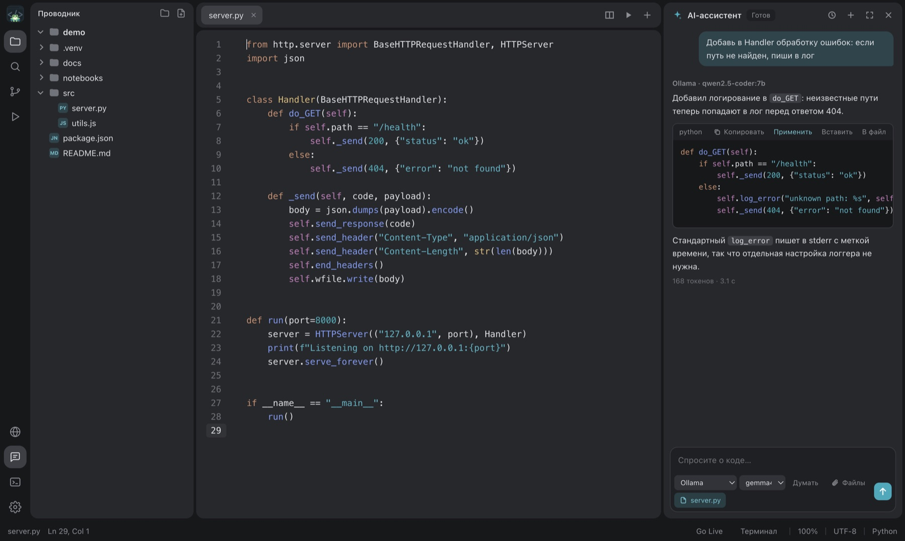

# FrogeeCodeIDE

Лёгкая IDE на Electron с ИИ, который работает на вашем компьютере. Подключите Ollama, LM Studio или свой провайдер: чат видит файлы проекта, предлагает правки, а вы принимаете или откатываете их кнопкой.



## Возможности

**ИИ**
- Чат с Ollama, LM Studio, OpenRouter и любыми совместимыми провайдерами.
- Файлы как контекст, редактирование и перегенерация сообщений.
- Проверка правок: изменения подсвечиваются в редакторе, «Оставить» или «Отменить» для файла.
- Подсказки по ходу набора (Tab принимает), с поддержкой FIM-моделей.

**Код**
- Подсветка синтаксиса, диагностика, поиск и замена, поиск по проекту.
- Jupyter-ноутбуки с автопоиском виртуальных окружений и выбором ядра.
- Конфигурации запуска, скрипты `package.json`, несколько терминалов.
- Live Server и встроенный браузер, предпросмотр Markdown, просмотр изображений.
- Проводник с перетаскиванием файлов между папками.

**Интерфейс**
- Liquid Glass (размытие окна только на macOS), светлые и тёмные темы в JSON.
- Несколько окон, меню Dock, восстановление вкладок.

## Запуск

Нужен Node.js 18 или новее.

```bash
cd src/code-redactor
npm install
npm start
```

## Сборка

```bash
npm run build:mac     # .dmg
npm run build:win     # установщик Windows
npm run build:linux   # AppImage / deb
```

Результат появится в `src/code-redactor/dist`.

## Плагины

Как в FgSNotes: плагины — файлы `.js` и `.css` в `~/Documents/FrogeeCodeIDE/plugins`. Настройки → Плагины → «Установить…» копирует их туда и включает; кнопки плагинов появляются на левой панели, лишние уходят в меню «…». API и примеры (Exildraw, вставка даты) — в [plugins/](plugins/README.md).

## Расширения

Расширения для FrogeeCodeIDE — обычные папки с `extension.json`, плагинами, темами и сниппетами. Они лежат в каталоге на сайте проекта ([extensions.html](https://arduradiokot.github.io/ForgeeCodeIDE/extensions.html)) и ставятся из панели «Расширения» в один клик или из папки на диске; их плагины работают полностью. Поиск в той же панели идёт по Open VSX: из расширений VS Code берутся темы и сниппеты, их код не запускается. Формат, примеры и сборка каталога (`node scripts/build-extensions.js`) — в [extensions/](extensions/README.md).

Расширение [Processing Mobile](extensions/processing-mobile/README.md) добавляет эмулятор Processing, экспорт Android-проекта и сборку APK из `.pde`.

## Настройки и темы

Конфигурация хранится в `~/Documents/FrogeeCodeIDE/config`. Свои темы кладутся в `themes/`, формат описан в [src/code-redactor/themes/README.md](src/code-redactor/themes/README.md).

## Структура

```
src/code-redactor/
  main.js, preload.js   процесс Electron и мост IPC
  lib/                  файлы, терминал, ИИ, окружения Python
  renderer/             интерфейс (ES-модули)
  styles/               стили
  themes/               темы
website/                сайт проекта
```

## Платформы

macOS проверена полностью. Windows и Linux собираются, но размытие окна там заменено непрозрачной темой.

## Лицензия

MIT, Frogeesoft.
